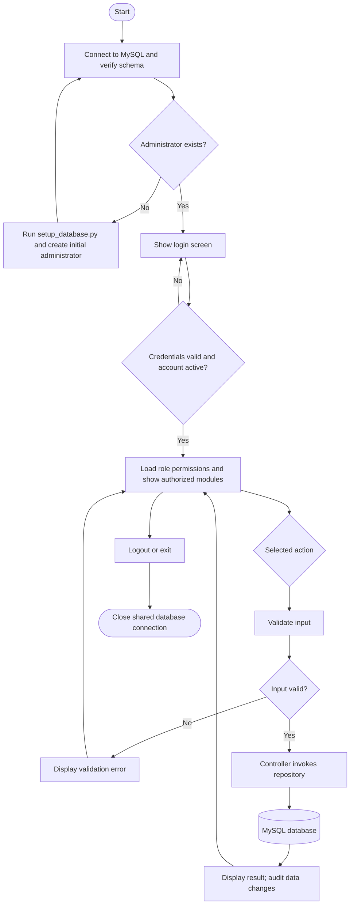
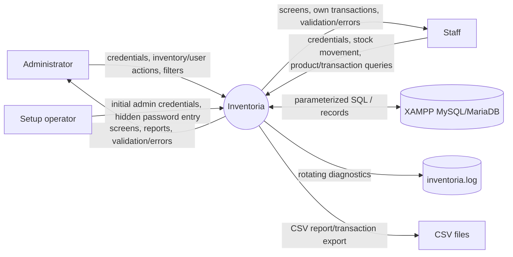
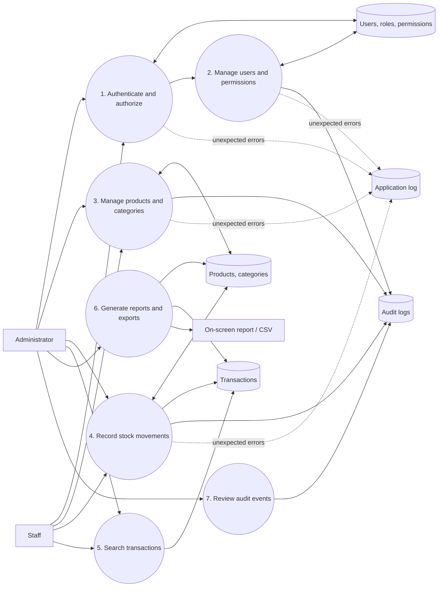
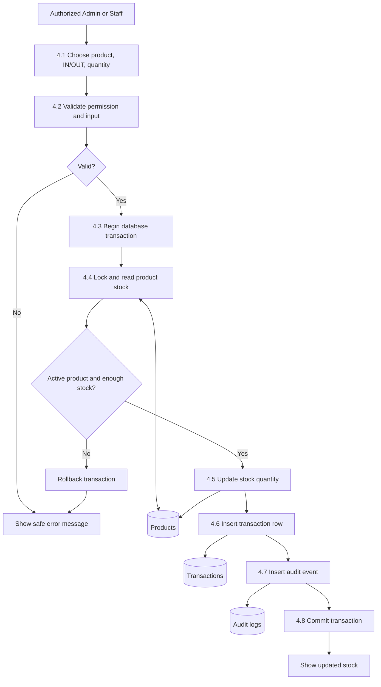
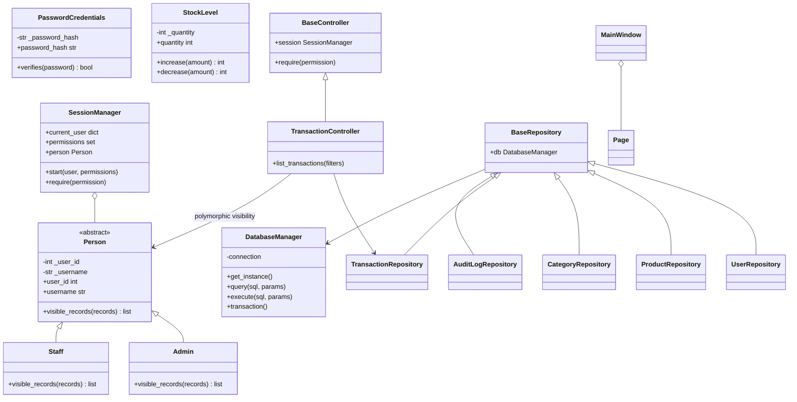
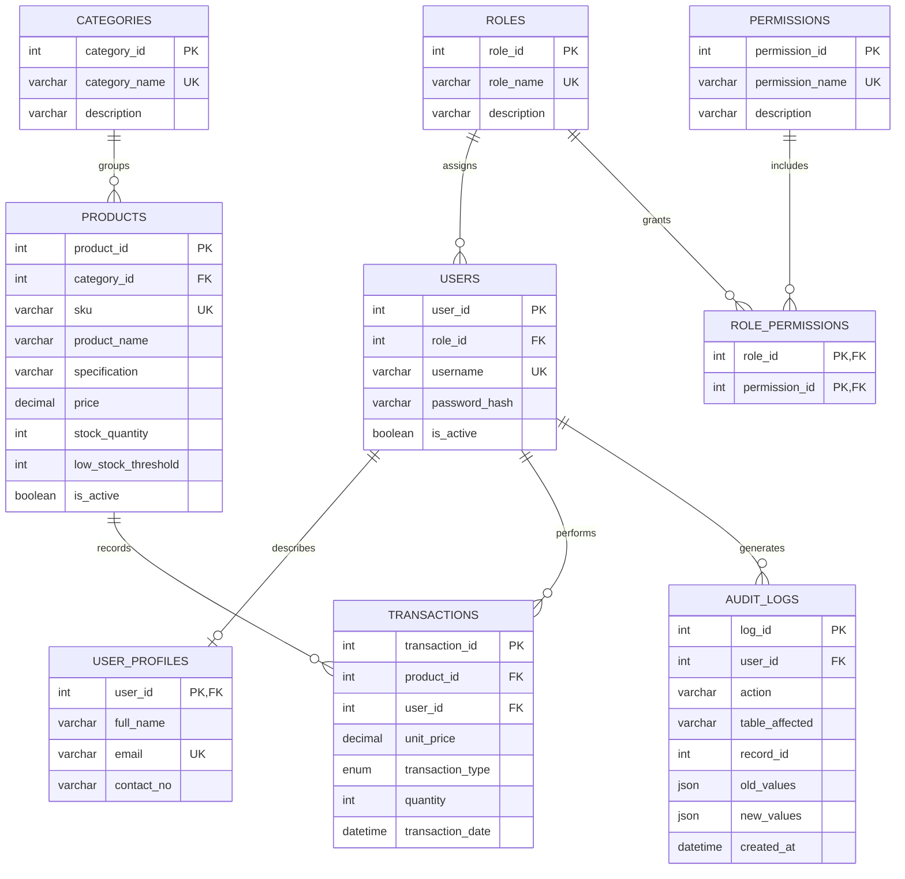

# Inventoria Design Documents

These are editable diagram sources for the design-document deliverables. Render the labeled Mermaid diagrams in a Mermaid-compatible editor, then export/print each diagram to PDF for the final submission.

## 1. System flowchart

## 2. Context diagram

## 3. Level-1 data-flow diagram

## 4. Level-2 DFD: stock movement

## 5. UML class diagram

## 6. Entity-relationship diagram

The authoritative DDL, indexes, constraints, seed roles, and seed permissions are in `database/inventoria_schema.sql`.
